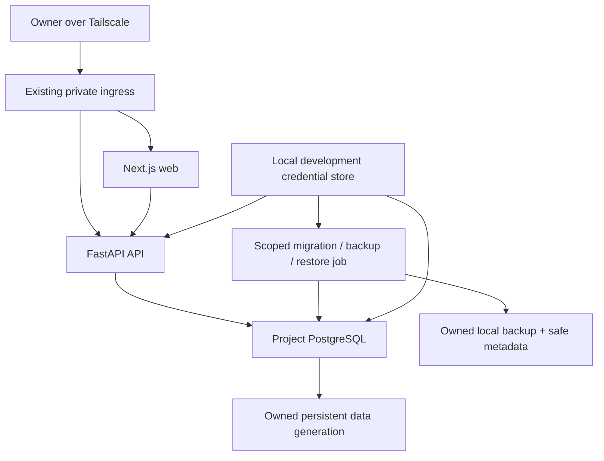

# TDD-026: Per-project PostgreSQL development runtime

- **Status:** Implemented — merged; managed/client acceptance pending
- **Owner:** Project owner
- **Date:** 2026-10-11 (America/New_York)
- **Specification:** [SPEC-026](spec.md) · **Tasks:** [TASKS-026](tasks.md)

## Approach and boundaries

Extend [project_groups.py](../../scripts/project_groups.py) and the existing
[private app lifecycle](../../scripts/private_apps.py), not a second manager or
arbitrary Compose executor. Add one managed database adapter beside the existing
Next.js and FastAPI adapters. Keep one project identity, operation lock and route
set; storage/credential ownership must survive replacement of runtime receipts.

Use PostgreSQL 18 as the proposed supported major, an exact Linux-amd64 image digest
and matching client tools. Validate the maintained patch/image and installed Podman
4.9/Quadlet compatibility before release; a major-family choice is not an approved
artifact pin. Do not install a database or client packages on the host. Application
access uses SQLAlchemy 2 with Psycopg 3; Alembic supplies source-controlled migrations
under the inherited uv dependency/toolchain policy. Final compatible versions are
locked and checked in the new release, not floating runtime downloads.
See the primary [SQLAlchemy PostgreSQL dialect](https://docs.sqlalchemy.org/en/20/dialects/postgresql.html)
and [Alembic tutorial](https://alembic.sqlalchemy.org/en/latest/tutorial.html).

Local credentials are the project owner's explicit development choice. This narrows
the directional [external-secret preference](../platform/architecture.md) for the
synthetic development slice. No AWS Secrets Manager, IAM, bucket, Terraform or host
privilege change is needed. The broader production secret/recovery design remains
separate. Resource isolation does not create a hostile-project security boundary
between processes sharing forge's identity.



The arrows from the store denote selected read-only credential-file mounts, not
credential transmission through the frontend or gateway. Browser API requests use
the existing same-origin private prefix. There is no database ingress route.

## Versioned source contract

Propose project schema v4 with exactly `web`, `api` and `db`; web depends on API,
API depends on the managed database. Web/API retain disjoint source roots and exact
toolchain metadata. DB is a fixed trusted adapter/profile reference, not a source
root with arbitrary build/start commands. Data mode explicitly becomes persistent.
Migration/seed argument vectors resolve only inside the selected API container,
under existing execution authorization and frozen dependencies.

Declare no secret values, environment maps, host paths/ports, arbitrary images,
SQL strings, plugins or external database hosts. Allow only the reviewed database
profile and closed supported topology. Validator filesystem inspection stays
observation-only and never reads credential/data files. Keep bundled local-only
schemas, parser/size/depth protections, sanitized errors and v1–v3 semantics.
Version catalogue metadata and provider/group receipts explicitly where shapes
change; choose their free version IDs from actual registries during implementation.
Old providers refuse before mounting or deleting any persistent resource.

Generation creates source/provenance/complete locks only. The new persistent starter
has its own release ID and content digest; `notes@1.0.0` remains ephemeral. Existing
projects require explicit opt-in to the new release/contract. Importing old in-memory
notes is excluded. A declaration alone never authorizes creation/reset of data.

## Storage, identity and credentials

Proposed owned layout on the existing encrypted project volume:

```text
/srv/forge/projects/<id>/                    # application repository
/srv/forge/projects/.gptclaw-runtime/v1/data/projects/<id>/               # separate persistent ownership root
  owner.json                                # project binding / format / major
  credentials/<epoch>/<role>.json            # admin, migration, runtime; secret
  postgres/<generation>/                    # image-compatible PGDATA layout
  backups/<backup-id>.dump                   # secret-free roles, sensitive payload
  backups/<backup-id>.json                   # bounded safe metadata / checksum
```

Runtime state outside source stores the active generation, credential epoch,
operation stages and ownership references. Credential/data formats require explicit
versions. Use atomic, fsynced metadata replacement and operation journals to recover
between external actions; never confuse runtime cleanup with data deletion.

Verify `/srv/forge` is the expected existing mount before allocation and every
mutation. Use trusted base paths, no-follow regular-file/directory handling, owner,
mode and link-count checks; generated path components come from validated identities.
Uninitialized and initialized states differ persistently. Once initialized, missing
PGDATA/credentials or owner marker is a recovery failure, not permission to initdb.
Store image-major/layout metadata before mounting; refuse incompatible versions.
Apply UID mapping only to a newly allocated owned data tree, never recursive chown
of source or arbitrary host paths. Verify the pinned image's PGDATA/container UID
contract in rootless integration tests, including replacement and shutdown.

Generate cryptographically random independent role credentials in trusted platform
code with umask 077; atomic mode-0600 writes under mode-0700 owned directories.
Use immutable epoch files, and selected per-operation snapshots under forge's
verified private runtime directory. Read-only bind mounts expose only the necessary
role file at a fixed container path. Do not mount the store directory, forge's home,
cloud credentials, container socket or another project's data. Set container UID
and file ownership so the intended process can read the snapshot without making
credentials world-readable; validate this against actual rootless mappings.
Remove only owned transient snapshots after processes stop; retained store survives.

API settings take a non-secret credential-file path and safe DB endpoint, build the
connection in memory and hide SQL parameters/passwords from logging/errors. Jobs
use private passfiles or in-process connections; no password-bearing command line,
connection URL, environment value, Quadlet content or subprocess diagnostic is
allowed. Bootstrap creates database roles/grants through a trusted container helper;
initialization credentials must not silently reset existing roles. Explicitly revoke
default public schema/database grants and grant only the selected privilege roles.
Local authentication configuration rejects trust access from application peers. App role can CRUD owned
application tables/sequences but cannot DDL/create roles/create databases; migration
role owns only the application schema, and admin is restricted to managed jobs/DB.

Rotation requires the group stopped and its project lock. Create new versioned login
roles retaining per-project runtime/migration grants, stage new
credentials, verify DB login/grants, atomically select the epoch, then revoke old
logins. Transfer application objects from every retained, validated migration identity
to the selected migration role before epoch selection. Foreign-key checks execute
as table owners, so inheriting an old role alone does not preserve writes after
schema ownership changes. Never transfer admin/runtime ownership; repeat safely
when recovering an interrupted rotation or repairing a previously rotated epoch.
Journal each transition so interruption cannot discard the last usable
credentials; admin credential rotation similarly stages/verifies a replacement
administrative login before revocation. Exclude automatic background rotation. A running, failed or unknown database
operation journal blocks readiness even when its current login and schema query
work; recover and resume the recorded operation before publishing the route.
Snapshots may retain old secret files: revocation, not file deletion alone, removes
their database authority. Never promise that file modes protect against forge.

## Network, lifecycle and resource budgets

Keep the existing web/API network and add an owned internal backend network joining
DB, API and only bounded managed jobs. Web is not attached to the backend network.
No DB host publication, Serve/Funnel path, host-network mode or admin UI is allowed.
Test actual peer connectivity/authentication; do not treat an internal network as a
substitute for role isolation. Preserve existing loopback web/API publication and
host IMDS settings without claiming new cloud-credential isolation.

Proposed initial ceilings: DB 1 CPU, 1024 MiB, 128 PIDs and 30 PostgreSQL connections;
API pool max 5 plus overflow 5, leaving capacity for scoped jobs/readiness. Retain
web/API ceilings of 1 CPU, 1536 MiB and 256 PIDs each; sum is 3 CPU, 4096 MiB and
640 PIDs per group, not a promise those resources are reserved. Build/quality and
migration/backup jobs run serially under existing finite limits. Preflight actual
host headroom before trials; refuse/report inadequate capacity without resizing.

Start validates source, durable ownership, credential epoch and pinned image; acquires
the project lock; starts DB; probes an authenticated query and expected Alembic
revision; starts API with its selected credential file; starts web; then publishes.
Initial provisioning/migration is an explicit operation before the first ready start.
Ordinary start/reload checks migrations but never applies them. If startup fails,
reverse only newly created owned runtime resources, retaining every allocated data
generation and recovery journal. Stop withdraws routing, stops web/API then DB;
allow up to 60 seconds for graceful PostgreSQL shutdown before reporting failure.
No cleanup stage may remove a data directory when shutdown is unconfirmed.

Retain existing bounded jobs/readiness; report separate stage timings. Status observes
actual processes, authenticated DB readiness, schema revision, data generation,
backup verification age and unresolved operation stage. Do not execute project
migration code merely to answer status. DB outage withdraws useful group routing
and yields unavailable note operations, then recovers without recreating data.
A failed migration is a blocked readiness state, never healthy from stale receipts.

## Migrations and operation plans

Proposed CLI operation family: `db status`, `db migrate plan/apply`, `db backup`,
`db restore plan/apply`, `db reset plan/apply`, `db seed`, `db rotate plan/apply`
and `db prune plan/apply`. These names are design proposals, not installed commands.
Final syntax must be documented/tested with provider capabilities before activation.

Every mutation holds the group lock and a persistent operation ID. Plan receipts
bind project/root ownership, active generation, schema revision, source/lock/migration
fingerprints, credential epoch, backup and exact requested action. Apply revalidates
all bindings and confirmation; plans cannot be replayed after state/source changes.
Plans show affected revisions/targets and recovery path, never source payloads or
credentials. Migration planning can inspect declared revisions and generate bounded
SQL in a scoped container; executing application migration code requires the same
reviewed executor boundary, never host import. SQL preview is not a safety proof.

All existing-database migrations require a backup taken after routes/writers are
stopped, with DB remaining up for the scoped job. Restore-check that dump in an
isolated generation before apply, using database-level checks for the backed-up
revision rather than requiring the newer application head. The backup must be made
and verified during the same locked stopped-writer operation; resumed writers or
release of that lock invalidate its pre-change eligibility. Bind the result to the
unchanged source generation and revision. Bootstrap of an empty owned DB is a separate initial operation.
Require one Alembic head in the first slice; reject unknown/ahead/divergent histories.
Failed jobs retain safe stages and block new publication pending explicit reconcile.
Restore is the recovery path; destructive/nontransactional migrations are never
assumed reversible from an automatic `downgrade`.

## Backup, restore, reset and pruning

Use matching exact-image `pg_dump` custom format with bounded runtime, safe errors,
no exported role passwords and atomic temporary-file publication. Record checksum,
image/major, schema and generation, completion time and verification state. On-demand
backup may run against a ready app with PostgreSQL's consistent snapshot; a backup
used for a destructive plan must be made in the stopped-writer state. Restore-check
runs with app credentials and asserts schema/constraints plus bounded project
verification tests; synthetic acceptance compares deterministic record hashes.

Restore only an owned same-project artifact. Validate metadata/digest before restore;
archives remain executable database content and are not safe merely because a hash
matches. No arbitrary import/downloaded dump is supported. Stage a new owned PGDATA
with platform roles freshly provisioned from credentials; restore application objects
using `--no-owner --no-acl`, apply canonical grants, verify the recorded revision, constraints and database-level CRUD. Before promotion,
require compatible application source and its declared migration head; an old-schema
restore must not start incompatible newer code. A schema rollback therefore also
needs an explicitly reviewed compatible source revision, not an automatic Git reset.
Do not copy role credentials into backup metadata. Error leaves active pointer
unchanged. Explicit stopped promotion atomically switches generation references and
retains the previous generation for checked rollback; interrupted promotion must be
reconciled before another start. Reset follows the same staging/promotion path with
an empty migrated database and optional fixed synthetic seed.

Primary references: [pg_dump](https://www.postgresql.org/docs/18/app-pgdump.html)
and [pg_restore](https://www.postgresql.org/docs/18/app-pgrestore.html). A logical dump
covers one database; platform-managed roles/grants are recreated separately. These
are local application-recovery artifacts, not a proven volume/host recovery system.
Existing DLM settings/silent-failure acceptance remain unchanged. Native backup
scheduling, independent exports and restore-volume/host exercises are deferred.

Propose at most seven completed dumps and 1 GiB of dump storage per synthetic
project, each dump <=128 MiB, plus a minimum 512 MiB remaining volume headroom after
the estimated job allocation. Reject new work when count/bytes/free-space gates
cannot be met; do not auto-delete to make space. Limit retained inactive generations
to two; if either is protected by recovery/rollback, require a reviewed prune plan
or refuse further staging. Record observed PGDATA size and preflight free space for
staged copies; container memory limits do not bound disk growth. These limits are
conservative draft defaults, finalized against measured synthetic workload in review.

Prune explicitly selected owned IDs after confirmation under the project lock; never
active, sole-verified, in-progress or plan-referenced data. Preserve credentials and
unknown files. Credential files/backups are private development material on encrypted
EBS, not plaintext evidence. Snapshots can still contain pruned copies until existing
retention expiry; deletion of local files does not establish erasure.

## Persistent notes and verification

Create a separate release with the same UI/typed API behavior and durable SQLAlchemy
repository. Use bounded transactions, constraints and a serialized capacity check
(e.g. an owned lock row) for the 100-note demo limit. No auth/accounts or real note
payload logging. Explicit seed inserts deterministic synthetic fixture records and
refuses conflicting existing data; it never truncates on start. Python standards,
locked quality/security/coverage and exact frontend checks remain required.

Offline tests cover schema/compatibility, ownership, local-secret canary leakage,
plan freshness, operation locks/journals, limits, interruptions and protected pruning.
Real rootless integration uses pinned PostgreSQL, role/network refusal, source reload,
stop/start/container replacement, migrations, corrupted backups, staged restore/reset,
credential rotation failure/recovery and two-project isolation. Generated CI adds
actual database/browser persistence and backup/restore tests. Checks use synthetic
fixtures and narrowly owned cleanup; no host installs or live data reset.

After implementation and named-fixture authorization, install the reviewed immutable
provider and run managed EC2 tests with two synthetic database projects while a
legacy web/API/ephemeral group stays usable. Measure memory/disk/job timings; record
local, CI, EC2, independent owner browser and acceptance separately. User confirms
create/edit/refresh and persistence after a managed restart at the private URL.
Cleanup of retained data requires its own reviewed target/backup/confirmation.

Rollout does not migrate existing apps or alter AWS. Rollback first stops the selected
persistent group with the capable provider, reconciles jobs and preserves data/store/
backups, then restores the reviewed provider snapshot. An older provider must refuse
the new manifest/receipt before mutation. Application/schema rollback uses a proven
stopped generation restore; provider rollback alone cannot undo database migrations.
PostgreSQL major upgrades and host-loss recovery are separate work. Do not claim
local restore tests close outstanding RES acceptance or production readiness.

## Traceability and decisions

| Requirements | Design mechanism | Tasks | Acceptance |
|---|---|---|---|
| DB-001 | Versioned closed topology/catalogue/provider compatibility | T-003 | AC-001 |
| DB-002 | Durable ownership, generation markers and no implicit init/delete | T-004 | AC-002 |
| DB-003 | Local role store, selected mounts, privilege split and epoch rotation | T-005 | AC-003 |
| DB-004 | Project lock, backend network, readiness and staged lifecycle | T-006 | AC-002, AC-004 |
| DB-005 | Alembic revisions and backup-bound plan/apply gates | T-007 | AC-005 |
| DB-006 | Matching pg_dump/restore, validation and staged promotion | T-008 | AC-006 |
| DB-007 | Generation reset/seed and confirmed bounded pruning | T-009 | AC-007 |
| DB-008 | New persistent release, database/browser/golden checks | T-010 | AC-008 |
| DB-009 | Runbooks, regression/CI/live/client evidence and acceptance | T-011, T-012 | AC-009 |

The local-secret decision is settled by the project owner. Implementation approval includes the synthetic-only logical-recovery
prerequisite; broad stage-7 exercises remain separately deferred. Implementation review and acceptance remain separate gates. Implementer finalizes exact image/locks,
version IDs, UID mapping, job budgets and syntax before runtime activation; unsupported
capability blocks the dependent step rather than causing a privileged workaround.

The implementation selects PostgreSQL 18.6 at the immutable profile digest, provider
1.8.0, project/catalogue v4 and group receipt v3. The closed persistent release is
`notes-postgres@1.0.0`. Native dumps are stopped-writer operations in this first
slice. `db recover` reconciles an exited unknown job receipt without replaying SQL;
interrupted rotation resumes its exact epoch/operation. All test/verify database
work uses task-owned disposable fixtures, preserving managed live data.

The managed database bypasses the image's generic initializer with the immutable
provider's trusted `start-development-postgres.sh`. Initialization uses `--pwfile`,
and SQL clients use passfiles; no file password is exported into process environments.
The helper supports the pinned image's rootless UID behavior, refuses partial/foreign
PGDATA and raw password environment inputs, and admits SCRAM-authenticated peers
only to the app database on the owned private backend. Docker verification uses a
task-owned empty client configuration rather than forge's host configuration.

## Managed acceptance storage-layout correction (1.8.2)

The first authorized managed initialization failed before allocation because the
volume mount is root-owned and `/srv/forge/data` is absent. The forge identity can
write the existing private runtime directory on that same volume. Use its
`v1/data/projects/<id>` subtree, outside every repository, with private owned
directories and unchanged per-project generations/credentials/backups. This is an
unprivileged source/provider correction, with no host ownership or AWS change.

Add the closed `database.storage: runtime-volume-v1` selector to newly generated
v4 manifests. Older providers' strict schemas reject it before execution. New
database operations require the selector; an older v4 manifest reports that a
reviewed storage upgrade is needed rather than treating data as newly uninitialized.
A legacy data-store directory must be explicitly migrated in separate reviewed work,
never silently shadowed or auto-copied. Both authorized targets have no allocated
database/credentials or legacy data directory, so only their source selector changes.

Verify fresh generation, old-schema refusal, absent-selector preflight, private
store permissions and legacy-store refusal in isolated fixtures; then repeat
managed initialization and acceptance through the reviewed provider after merge.
